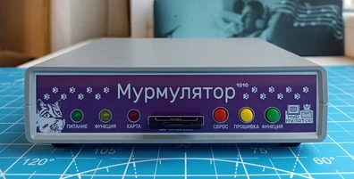
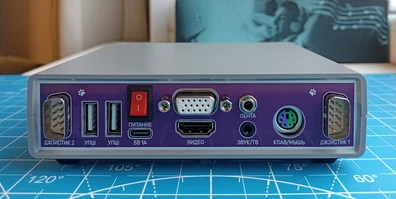
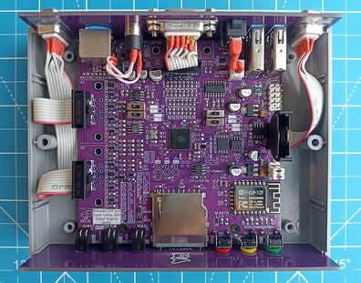
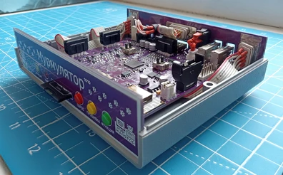

## Murmulator.1010
10×10 cm, 2-layer DIY computer PCB based on the Raspberry Pi RP2350 MCU

Technical specs:
- Compatible with the [Murmulator](https://murmulator.ru/) [M2P2](https://murmulator.ru/nextgen)
  and [Frank PGA](https://frank.rh1.tech/ru-ru/hardware/frank-pga) projects
- HDMI and VGA video outputs
- CVBS composite video + audio output via 3.5mm jack connector
- PWM and I2S (TDA1387T DAC) audio output with LMV358 opamp
- Combined PS/2 keyboard and mouse port
- Two DB-9 ports for Famicom (Dendy)-compatible joysticks
- Two external USB-host ports and two internal connectors via an MW7211A hub
- USB Type-C power supply and programming
- RP2350B MCU in a QFN-80 package
- 16MB SPI flash (W25Q128)
- Two PSRAM chips: SPI + QSPI
- RTC (DS3231MZ) with battery
- ESP8266 WiFi module (ESP-01 or ESP-12E/F)
- SD/microSD card slot
- Tape input via a second 3.5 mm jack
- ESD protection for PS/2, joystick, and USB Type-C ports
- 5V level shifters for PS/2 and joystick ports
- Board optimized for G738 and G706 cases

### Changelog
#### Main PCB
* Rev.A - initial release
* Rev.A1:
    - U6 marked as DNP
    - Minor silkscreen improvements

#### Covers PCB
* Rev.A - initial release
* Rev.A1:
    - HDMI and USB cutouts moved down by 0.25mm
    - PS/2 cutout moved up by 0.25mm

### MCU pinout
| GPIO | Function |
| ---- | -------- |
| GP0  | PS/2 mouse clock |
| GP1  | PS/2 mouse data |
| GP2  | PS/2 keyboard clock |
| GP3  | PS/2 keyboard data |
| GP4  | SPI SD card and PSRAM MISO |
| GP5  | SPI SD card select |
| GP6  | SPI SD card and PSRAM clock |
| GP7  | SPI SD card and PSRAM MOSI |
| GP8  | SPI PSRAM select |
| GP9  | I2S data / PWM beeper |
| GP10 | I2S clock / PWM R |
| GP11 | I2S LR clock / PWM L |
| GP12 | HDMI CKN / VGA B bit 0 / CVBS bit 0 |
| GP13 | HDMI CKP / VGA B bit 1 / CVBS bit 1 |
| GP14 | HDMI D0N / VGA G bit 0 / CVBS bit 4 |
| GP15 | HDMI D0P / VGA G bit 1 / CVBS bit 5 |
| GP16 | HDMI D1N / VGA R bit 0 / CVBS bit 2 |
| GP17 | HDMI D1P / VGA R bit 1 / CVBS bit 3 |
| GP18 | HDMI D2N / VGA horizontal sync / CVBS bit 6 |
| GP19 | HDMI D2P / VGA vertical sync |
| GP20 | NES joystick 1+2 clock |
| GP21 | NES joystick 1+2 latch |
| GP22 | Tape input |
| GP23 | — |
| GP24 | User button |
| GP25 | User LED |
| GP26 | NES joystick 1 data |
| GP27 | NES joystick 2 data |
| GP28 | RTC I2C SDA |
| GP29 | RTC I2C SCL |
| GP30 | — |
| GP31 | Test point TP4 |
| GP32 | Test point TP5 |
| GP33 | Test point TP6 |
| GP34 | — |
| GP35 | — |
| GP36 | — |
| GP37 | — |
| GP38 | ESP UART RX (MCU output) |
| GP39 | ESP UART TX (MCU input) |
| GP40 | — |
| GP41 | — |
| GP42 | — |
| GP43 | — |
| GP44 | — |
| GP45 | — |
| GP46 | Test point TP7 |
| GP47 | QSPI PSRAM select |

### References
* Murmulator official site: [link](https://murmulator.ru/)
* Murmulator 2 pinout and firmware: [link](https://murmulator.ru/nextgen)
* Frank PGA: [link](https://frank.rh1.tech/ru-ru/hardware/frank-pga)
